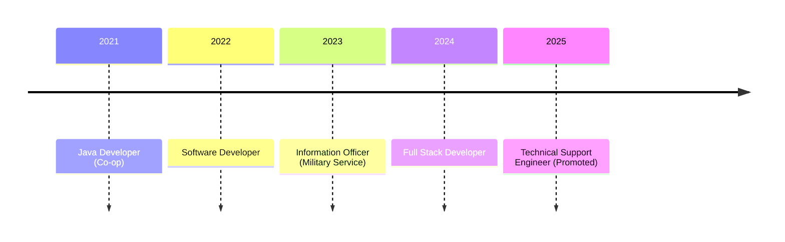

<!-- GitHub profile README (repo pharadornb/pharadornb). Derived from ../public.md only. -->
<!-- Snake section needs the workflow in github-snake.yml → .github/workflows/snake.yml in that repo. -->

  

  

Full Stack Engineer with nearly five years of experience building and supporting systems for medical devices and healthcare operations, from API and database design to containerized deployment and on-site support.

### 🔧 What I work on

- **Maintenance support system** for the technicians who service medical equipment, reducing reliance on Excel records (Go, React)
- **Multi-tenant healthcare operations platforms** (ASP.NET Core microservices, Ionic Angular)
- **Personal project**: ERP platform on Odoo with multi-tenant provisioning and customizable modules

### ⚡ Highlights

- Promoted to Technical Support Engineer in Dec 2025; resolve 20+ product cases a month
- Turned two days of manual cloud provisioning into a portal that does it in a few clicks (Angular, Ansible, Terraform)
- Restructured an army camp hospital's annual health check-up booking system for 4,000+ users

### 🗺️ Career

### 🧰 Stack

  

**Backend:** ASP.NET Core, Go, PostgreSQL, SQL Server 
**Frontend:** React, Next.js, Angular, Ionic 
**DevOps:** Docker, GitHub Actions, CircleCI, Nginx, Ansible, Terraform

🎓 B.I.S. Information Science (Enterprise Software), Suranaree University of Technology, Second-Class Honors 
🌱 Outside work: learning new frameworks, travelling and photography

### 📫 Connect

  <picture>
    <source media="(prefers-color-scheme: dark)" srcset="https://raw.githubusercontent.com/pharadornb/pharadornb/output/github-snake-dark.svg" />
    
  </picture>

  

